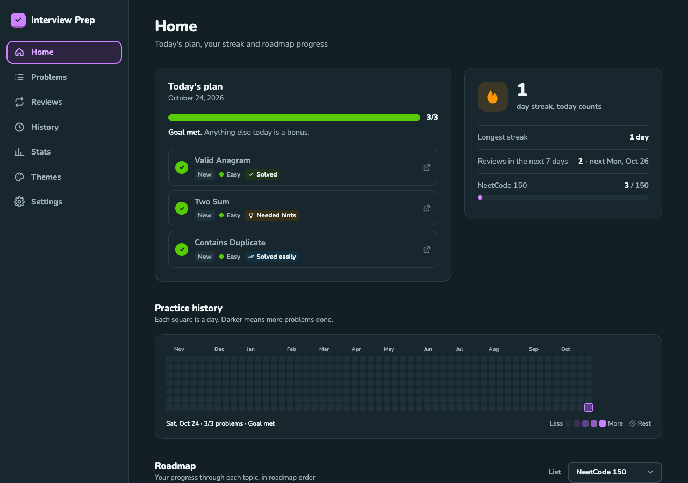
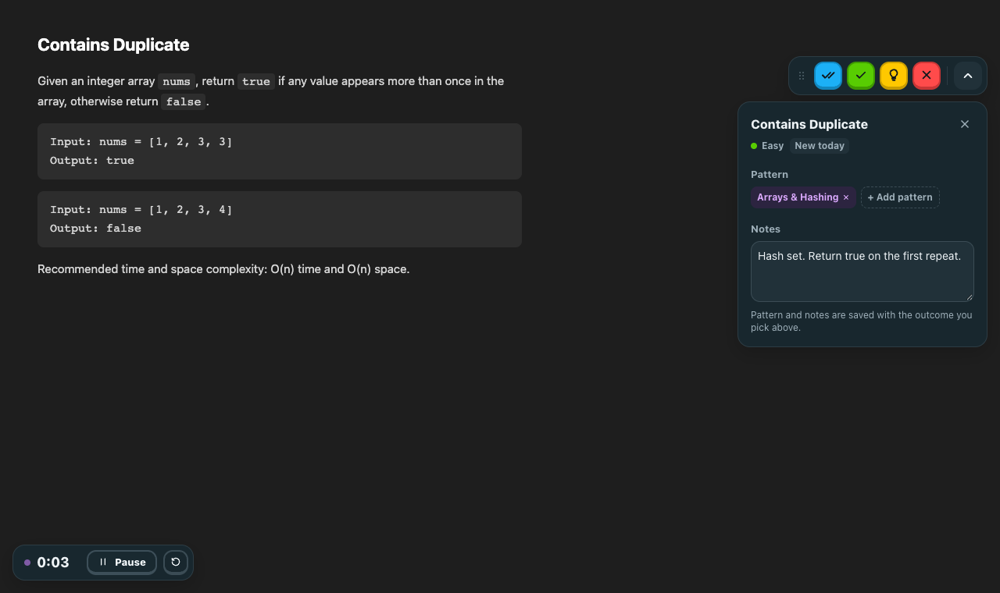
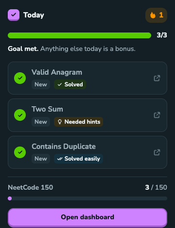
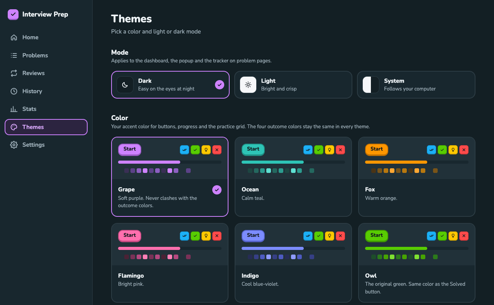

# Interview Prep

A Chrome extension I made to get through NeetCode 150, and then 250, without forgetting
everything a month later.

When I finish a problem on NeetCode or LeetCode, I click one button saying how it went. The
extension brings the problem back for a re-solve later, plans what to do each day, and keeps a
streak going.



## What it does

**Tracks problems where you solve them.** Every NeetCode and LeetCode problem page gets a small
toolbar with four buttons: solved easily, solved, needed hints, and didn't solve. There's an
optional timer in the bottom-left corner. Notes and the pattern you used go in a dropdown next
to the buttons. You can drag the toolbar anywhere on the screen.

**Brings problems back before you forget them.** Every problem you've done comes back for a
full re-solve. Each time you solve it, the gap gets longer: a few days, then two weeks, then a
couple of months. If you don't solve it, it's back the next day. Scheduling uses
[FSRS](https://github.com/open-spaced-repetition/fsrs4anki/wiki/ABC-of-FSRS), the same
algorithm behind Anki's newer scheduler.

**Plans each day.** You set a daily goal. Each day mixes reviews that are due with new problems
taken in NeetCode roadmap order, and always includes at least one review. A review cap means
coming back from a week off doesn't hand you 30 reviews at once.

**Keeps a streak.** Your history shows up as a GitHub-style grid. You can set weekly rest days,
or take a few extra each month, without losing the streak.

**Covers the main lists.** Blind 75, NeetCode 150, NeetCode 250 and NeetCode All. Solving a
problem on LeetCode counts toward the same problem on NeetCode, and the other way around.

**Also:** stats on weak topics and average solve times, an estimate of when you'll finish your
list, seven color themes, and light or dark mode.

<p>
  
  &nbsp;
  
</p>

Your data stays in your browser. There's no account, no server and no tracking. You can export a
backup from Settings at any time.

## Install

It isn't on the Chrome Web Store, so you build it yourself. You'll need Node.js 22 or newer.

```bash
git clone https://github.com/MuhammadHunainKhurram/interview-prep.git
cd interview-prep
npm install
npm run build
```

Then load it into Chrome:

1. Go to `chrome://extensions`.
2. Turn on **Developer mode** (top right).
3. Click **Load unpacked** and select the `.output/chrome-mv3` folder.

To update later, run `git pull && npm run build`, then click the reload icon on the extension's
card.

## How to use it

1. Open any problem on [neetcode.io](https://neetcode.io/practice) or leetcode.com.
2. If you want to time yourself, press **Start** on the timer in the bottom-left.
3. When you're done, click one of the four buttons in the top-right. That saves the attempt and
   stops the timer. Clicked the wrong one? Hit **Undo**, or fix it later from the History page.
4. Click the extension icon to see today's plan. **Open dashboard** has everything else.

A few extras:

- The arrow next to the buttons opens the pattern and notes. Fill those in before you pick an
  outcome.
- Drag the toolbar by its grip to move it. Double-click the grip to put it back.
- **Alt+Shift+S** jumps to the buttons. You can change it at `chrome://extensions/shortcuts`.

## Themes

Pick a color and light, dark or system mode from the Themes tab. The four outcome colors stay
the same in every theme, so you don't have to relearn them.



## Development

| Command           | What it does                                                  |
| ----------------- | ------------------------------------------------------------- |
| `npm run dev`     | Opens Chrome with the extension loaded and reloads on changes |
| `npm run build`   | Production build into `.output/chrome-mv3`                    |
| `npm run check`   | Typecheck, lint, format check and unit tests                  |
| `npm run e2e`     | Browser tests in Chromium (build first)                       |
| `npm run catalog` | Rebuilds the problem list from NeetCode's public data         |

Before the first `npm run e2e`, run `npx playwright install chromium`.

To refresh the screenshots in this README, run
`npm run build && README_SHOTS=1 npx playwright test e2e/readme-screenshots.spec.ts`.

### How it's put together

It's a Manifest V3 extension built with [WXT](https://wxt.dev), React, TypeScript and
Tailwind.

```
src/
  core/         Scheduling, daily plan, streaks and stats. Plain TypeScript, no browser APIs.
  data/         Storage, schema migrations and backups
  background/   The service worker. The only part that writes data.
  features/     One folder per screen: the on-page tracker, home, problems, reviews, and so on
  shared/       Message types, config and UI components
  entrypoints/  Where WXT wires everything up
```

A few decisions worth knowing about if you want to change things:

- Attempts are the only thing stored about your progress. Review dates are recalculated from
  them, so editing or deleting an attempt always leaves the schedule correct.
- Each day's goal and rest status is saved once that day starts. Changing your settings later
  doesn't rewrite your past streak.
- Every message between parts of the extension is checked with Zod, and so is everything read
  from storage. If something is ever corrupted, it's set aside rather than deleted.
- To add a dashboard page, add a folder under `src/features/` and an entry in
  `src/features/registry.tsx`.

[docs/DESIGN.md](docs/DESIGN.md) has the longer version.

### Configuration

There's nothing to configure for normal use. `.env.example` lists the optional settings, which
exist for a future sync backend. Anything in `.env` ends up inside the built extension, so never
put secrets there.

## Privacy

The extension only runs on `leetcode.com` and `neetcode.io`. It doesn't make network requests
or collect analytics. Everything is stored with `chrome.storage.local` on your machine.
